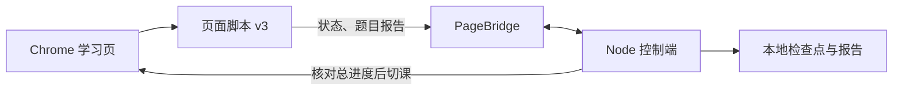

# 学习通 PageBridge 控制端

基于 [PageBridge](https://github.com/fannis9/pagebridge) 控制同一个已登录的 Chrome 标签，串行处理学习通章节任务，并将测验交给当前控制会话处理。项目包含页面脚本、监听控制端、跨课程队列和只读长时监测工具。

> 手动模式会报告测验并等待。自动模式能完成答题、填写和提交；验证码、登录验证、未知任务和状态冲突会暂停。页面结构可能变化；请先在自己的授权环境中测试。

## 登录后自动运行

一次性准备 `chaoxing-courses.json`（可从 `chaoxing-courses.example.json` 复制）和 `.env`（可从 `.env.example` 复制）。在 `.env` 填入自己的模型接口、模型 ID、密钥变量及 PageBridge 路径。DeepSeek 当前的 Responses API 地址是 `https://api.deepseek.com`，图像题可选 `deepseek-flash`；配置示例已填好非密钥字段。曾在聊天中发送过的密钥应吊销并换新。

```bash
node --env-file=.env chaoxing-auto.mjs
```

进程会等待登录，发现唯一的学习通标签后按课程配置进入章节，启动课程控制端。遇到测验时依次调用答题进程、页面填答器和页面提交控件；只有所有题目都有可用答案、填写全部确认后才提交，并等待平台确认完成。任何题目需复核、页面结构不符、模型接口失败或平台不确认时，写入 `quiz-reports/auto-events.jsonl` 并停在该测验。`--tab=<标签ID>` 可指定标签。首次配置课程、模型与 PageBridge 授权后，日常只需保持此进程运行并登录学习通。

若希望电脑登录后自动启动此进程，可将 `chaoxing-auto.service.example` 中的仓库绝对路径替换为本机路径，安装为用户级 systemd 服务。服务会等待学习通登录，不会保存学习通密码。

## Chrome 右侧控制台

`extension/` 是独立的 Chrome 扩展。打开 `chrome://extensions`，开启开发者模式，点击「加载已解压的扩展程序」，选择本仓库的 `extension` 目录。更新源码后，在扩展卡片上点击「重新加载」，再重新打开侧栏。扩展仅在 `https://chaoxing.com` 及其子域名标签上启用侧栏；点击工具栏图标可打开控制台。控制台每 3 秒直接读取当前标签的章节名称、任务状态、测验和日志，已打开的学习页无需刷新；也可停止本页脚本。Chrome 的侧栏位置由浏览器设置决定；如果当前设在左侧，在 Chrome 侧栏设置中切换到右侧。扩展不读取模型密钥，也不向第三方发送数据。

侧栏的运行控制、模型配置和对话通过本机 `127.0.0.1:8788` 连接 `chaoxing-console.mjs`。用户服务文件是 `chaoxing-console.service`，由 Node.js 读取本机 `.env`。侧栏保存的模型 ID、基础地址与密钥变量名写在 `quiz-reports/console-state.json`，密钥仍从 `.env` 指定的变量读取。修改密钥后重启控制服务。暂停会停止页面脚本和自动控制进程，继续会从控制端保存的课程状态重新启动。模型对话记录保存在同一状态文件中。

## 架构



- **页面脚本** [`chaoxing-autoplay-v3.js`](chaoxing-autoplay-v3.js)：在当前章节识别文档、视频、测验；逐项等待平台任务状态确认，再点下一节。只使用页面播放器，不伪造视频进度上报。隐藏任务标签中的视频也按播放器状态处理。浏览器 Web Lock 防止同源多标签同时启动。
- **控制端** [`chaoxing-quiz-control.mjs`](chaoxing-quiz-control.mjs)：通过 PageBridge 读取页面状态、保存题目 JSON/HTML/PNG、意外刷新后重注入、记录异常，并报告答题工作进程的结果。
- **答题工作进程** [`chaoxing-answer-worker.mjs`](chaoxing-answer-worker.mjs)：独立扫描本地测验报告，调用 OpenAI Responses API，校验题目 ID 和答案格式，再写入本地答案建议文件。它不连接浏览器，也不提交测验。
- **页面填答器** [`chaoxing-page-filler.mjs`](chaoxing-page-filler.mjs)：经 PageBridge 核对课程、章节、测验和题目控件，将已确认可填的答案写入原页面，并生成本地填写记录。
- **自动调度器** [`chaoxing-auto.mjs`](chaoxing-auto.mjs)：登录后发现课程，串行运行控制端、模型答题、页面填写与提交；遇到不确定状态停下并记录。
- **调度器**：控制端在当前课程最后任务章节停下，打开课程目录核对「已完成任务点」总数；核对成功才在同一标签进入下一门课。队列只按一门一门执行。
- **后台启动器** [`chaoxing-controller-daemon.mjs`](chaoxing-controller-daemon.mjs)：让控制端脱离交互终端继续运行。

## 准备

1. 安装 Node.js 20+、Chrome 和 [PageBridge](https://github.com/fannis9/pagebridge)。PageBridge 需要能够对学习页执行 `--world MAIN`；扩展的「完全接管」由用户在浏览器中开启。
2. 在本目录运行 `npm install`。`playwright-core` 用于生成本地测验预览图和运行隔离测试，不负责连接真实浏览器。
3. 在已登录的 Chrome 标签打开 `https://mooc1.chaoxing.com/mycourse/studentstudy?...`。先停止其他学习通脚本，避免并发。
4. 如需跨课程，复制 `chaoxing-courses.example.json` 为 `chaoxing-courses.json`，填入自己课程的 `cpi`、课程 ID、班级 ID、首末任务章节 ID 和课程目录显示的任务点总数。此文件被 Git 忽略。

PageBridge 可放在本仓库的同级目录；放在其他位置时设置环境变量 `CX_PAGE_BRIDGE=/绝对路径/page.mjs`。用 `node /路径/page.mjs tabs` 查找学习页的标签 ID。

## 运行

只处理当前课程并监听题目：

```bash
node chaoxing-quiz-control.mjs --start --tab=<标签ID>
```

按 `chaoxing-courses.json` 调度多门课程：

```bash
node chaoxing-quiz-control.mjs --start --schedule --tab=<标签ID>
```

长时运行建议使用独立后台进程：

```bash
node chaoxing-controller-daemon.mjs --tab=<标签ID>
```

启动器固定使用 `--start --schedule`。已有控制端时可加 `--restart` 重启；仅查看运行状态可用：

```bash
node chaoxing-quiz-control.mjs --status
node chaoxing-quiz-control.mjs --schedule-status
```

页面左下角也有日志框和停止按钮；控制台可调用 `window.__cxV3.stop()`。`chaoxing-autoplay-v3-one-chapter.js` 是只处理一节的试运行版本。

## 测验与恢复

测验出现时，页面脚本进入 `waiting-quiz`，控制端在 `quiz-reports/` 生成 `quiz-*.json`、`.html` 和 `.png`，并在标准输出或 `controller.log` 打印事件。题目需在控制会话中处理。提交后，页面脚本会等待平台确认完成再继续；若页面已刷新，可在**完成提交之后**运行 `node chaoxing-quiz-control.mjs --resume --tab=<标签ID>`，它会核验原测验状态。不要在填写过程中执行恢复命令。

题目 JSON 还包含 `questionId`、选项的 `value`、`control.kind`、答案字段 ID、编辑器 ID 与填空数量。这些字段用于以后把答案准确对应到原页面控件；`captureIssues` 标记缺失的控件映射、字体或图片。特殊字体题和图片题会在 `quiz-*-questions/` 生成逐题 PNG 与 `manifest.json`，事件中提供 `questionPreviews` 路径。逐题预览仍是本地文件，遇到跨域图片无法嵌入时会在报告中保留图片路径并标记问题。

## 独立答题工作进程

在另一个终端设置 API 密钥并选择模型：

```bash
export OPENAI_API_KEY=你的密钥
node chaoxing-answer-worker.mjs --model=gpt-6.1-sol
```

将 `--model=` 后的值换成你账号可用的模型 ID。省略时默认 `gpt-6.1-sol`；也可设 `CX_ANSWER_MODEL`。命令行参数优先于环境变量。其他支持 OpenAI Responses API 及 `json_schema` 结构化输出的服务，可用 `--base-url=https://服务地址/v1` 指定接口，再用 `--api-key-env=密钥变量名` 指定密钥所在的环境变量；`CX_OPENAI_BASE_URL` 和 `CX_ANSWER_API_KEY_ENV` 也可用。接口地址必须是 HTTPS，本机测试可用 HTTP。不同服务对图片输入和结构化输出的兼容程度需要分别验证。

`CX_QUIZ_REPORT_DIR` 可指定与控制端共用的报告目录。只处理一次当前队列可加 `--once`；指定一个报告可用 `--once --report=/绝对路径/quiz-*.json`。首次运行会处理目录中尚无有效答案文件的报告。题目正文和已嵌入的图片会发送到选定模型接口；报告和结果都只保存在本地，输出文件权限为 `0600`。默认接口按 [OpenAI Responses API](https://developers.openai.com/api/reference/resources/responses/methods/create) 的结构化输出格式调用。切换模型或接口后会重新生成答案，结果中记录 `model` 和接口指纹，便于核对。

成功后生成 `quiz-reports/answer-*.json`。`status=ready` 表示映射检查通过；`status=needs-review` 表示题目缺字、缺图、缺控件或模型弃答。控制端会输出 `answer-proposal` 事件。工作进程重启后不会重复请求未变化的报告；报告变化时会重新求解。接口失败或答案值不在题目选项中时，不覆盖已有结果，并在标准错误输出原因。

## 页面填答器

先检查答案与当前页的对应关系，再明确执行填写：

```bash
node chaoxing-page-filler.mjs --answer=/绝对路径/quiz-reports/answer-0123456789abcdef.json --tab=<标签ID>
node chaoxing-page-filler.mjs --answer=/绝对路径/quiz-reports/answer-0123456789abcdef.json --tab=<标签ID> --apply
```

首条命令只输出 `fill-preview`；第二条才操作页面。省略 `--tab` 时需恰好有一个学习通章节标签。填答器核对答案文件的报告哈希、课程、章节、测验 ID、题目 ID、题干和控件映射。它跳过模型标记为需复核、缺失图片或字体、答案为空的题目。选择题点击原页面选项；普通文本框触发输入事件；富文本编辑器通过 UEditor 写入、同步并触发页面保存按钮。执行后保存权限为 `0600` 的 `fill-*.json` 记录。填写失败会停止后续题目并返回非零状态；它不点击测验提交按钮。页面脚本仍会等待平台确认测验完成后继续。

运行检查点在 `quiz-reports/runtime.json`，课程队列在 `schedule.json`，事件在 `events.jsonl`，异常在 `incident-*.json`。这些文件可能包含课程内容，默认不提交到 Git。浏览器内的 `sessionStorage['cx-v3-runtime']` 用于页面刷新恢复，但平台任务状态始终是完成与否的依据。

## 测试

隔离浏览器测试会拦截全部外部请求，不接触真实学习通账户。安装 Chrome 后执行：

```bash
npm test
```

Chrome 不在 `/usr/bin/google-chrome` 时设置 `CHROME_PATH`。只读观察现有控制端的心跳和异常，可运行 `node chaoxing-longrun-test.mjs 300 --allow-progress`；它不会操作页面。

## 边界与隐私

- 不保存账号密码、Cookie 或视频签名；课程入口参数只在当前浏览器会话中使用。
- 课程目录的任务点总数、章节 ID 或入口不匹配时，调度转为 `needs-review`，不会把课程记为完成。
- 页面刷新、登录态过期、播放器改版或任务状态不刷新，都可能使脚本保守停下。后台进程不等于无人值守 AI 答题。
- 运行前请确认课程允许使用自动化；遵守课程和平台要求。
