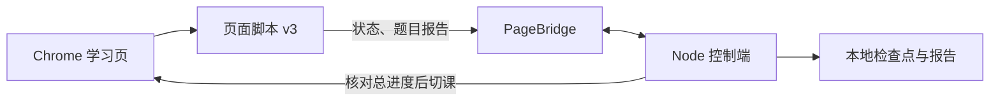

# 学习通 PageBridge 控制端

基于 [PageBridge](https://github.com/fannis9/pagebridge) 控制同一个已登录的 Chrome 标签，串行处理学习通章节任务，并将测验交给当前控制会话处理。项目包含页面脚本、监听控制端、跨课程队列和只读长时监测工具。

> 当前版本会**报告测验并等待**，后台控制端本身没有 AI 模型接口，不会自行作答或提交。验证码、登录验证、未知任务和状态冲突也会暂停。页面结构可能变化；请先在自己的授权环境中测试。

## 架构



- **页面脚本** [`chaoxing-autoplay-v3.js`](chaoxing-autoplay-v3.js)：在当前章节识别文档、视频、测验；逐项等待平台任务状态确认，再点下一节。只使用页面播放器，不伪造视频进度上报。隐藏任务标签中的视频也按播放器状态处理。浏览器 Web Lock 防止同源多标签同时启动。
- **控制端** [`chaoxing-quiz-control.mjs`](chaoxing-quiz-control.mjs)：通过 PageBridge 读取页面状态、保存题目 JSON/HTML/PNG、意外刷新后重注入、记录异常。它不把题目发送到第三方服务。
- **调度器**：控制端在当前课程最后任务章节停下，打开课程目录核对「已完成任务点」总数；核对成功才在同一标签进入下一门课。队列只按一门一门执行。
- **后台启动器** [`chaoxing-controller-daemon.mjs`](chaoxing-controller-daemon.mjs)：让控制端脱离交互终端继续运行。

## 准备

1. 安装 Node.js 20+、Chrome 和 [PageBridge](https://github.com/fannis9/pagebridge)。PageBridge 需要能够对学习页执行 `--world MAIN`；扩展的「完全接管」由用户在浏览器中开启。
2. 在本目录运行 `npm install`。`playwright-core` 用于生成本地测验预览图和运行隔离测试，不负责连接真实浏览器。
3. 在已登录的 Chrome 标签打开 `https://mooc1.chaoxing.com/mycourse/studentstudy?...`。先停止其他学习通脚本，避免并发。
4. 如需跨课程，复制 `chaoxing-courses.example.json` 为 `chaoxing-courses.json`，填入自己课程的 `cpi`、课程 ID、班级 ID、首末任务章节 ID 和课程目录显示的任务点总数。此文件被 Git 忽略。

PageBridge 可放在本仓库的同级目录；放在其他位置时设置环境变量 `CX_PAGE_BRIDGE=/绝对路径/page.mjs`。用 `node /路径/page.mjs tabs` 查找学习页的标签 ID。

## 运行

只处理当前课程并监听题目：

```bash
node chaoxing-quiz-control.mjs --start --tab=<标签ID>
```

按 `chaoxing-courses.json` 调度多门课程：

```bash
node chaoxing-quiz-control.mjs --start --schedule --tab=<标签ID>
```

长时运行建议使用独立后台进程：

```bash
node chaoxing-controller-daemon.mjs --tab=<标签ID>
```

启动器固定使用 `--start --schedule`。已有控制端时可加 `--restart` 重启；仅查看运行状态可用：

```bash
node chaoxing-quiz-control.mjs --status
node chaoxing-quiz-control.mjs --schedule-status
```

页面左下角也有日志框和停止按钮；控制台可调用 `window.__cxV3.stop()`。`chaoxing-autoplay-v3-one-chapter.js` 是只处理一节的试运行版本。

## 测验与恢复

测验出现时，页面脚本进入 `waiting-quiz`，控制端在 `quiz-reports/` 生成 `quiz-*.json`、`.html` 和 `.png`，并在标准输出或 `controller.log` 打印事件。题目需在控制会话中处理。提交后，页面脚本会等待平台确认完成再继续；若页面已刷新，可在**完成提交之后**运行 `node chaoxing-quiz-control.mjs --resume --tab=<标签ID>`，它会核验原测验状态。不要在填写过程中执行恢复命令。

题目 JSON 还包含 `questionId`、选项的 `value`、`control.kind`、答案字段 ID、编辑器 ID 与填空数量。这些字段用于以后把答案准确对应到原页面控件；`captureIssues` 标记缺失的控件映射、字体或图片。特殊字体题和图片题会在 `quiz-*-questions/` 生成逐题 PNG 与 `manifest.json`，事件中提供 `questionPreviews` 路径。逐题预览仍是本地文件，遇到跨域图片无法嵌入时会在报告中保留图片路径并标记问题。

运行检查点在 `quiz-reports/runtime.json`，课程队列在 `schedule.json`，事件在 `events.jsonl`，异常在 `incident-*.json`。这些文件可能包含课程内容，默认不提交到 Git。浏览器内的 `sessionStorage['cx-v3-runtime']` 用于页面刷新恢复，但平台任务状态始终是完成与否的依据。

## 测试

隔离浏览器测试会拦截全部外部请求，不接触真实学习通账户。安装 Chrome 后执行：

```bash
npm test
```

Chrome 不在 `/usr/bin/google-chrome` 时设置 `CHROME_PATH`。只读观察现有控制端的心跳和异常，可运行 `node chaoxing-longrun-test.mjs 300 --allow-progress`；它不会操作页面。

## 边界与隐私

- 不保存账号密码、Cookie 或视频签名；课程入口参数只在当前浏览器会话中使用。
- 课程目录的任务点总数、章节 ID 或入口不匹配时，调度转为 `needs-review`，不会把课程记为完成。
- 页面刷新、登录态过期、播放器改版或任务状态不刷新，都可能使脚本保守停下。后台进程不等于无人值守 AI 答题。
- 运行前请确认课程允许使用自动化；遵守课程和平台要求。
